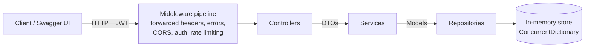

# Address Book REST API

A REST API for managing a personal address book: create, edit, delete, search, sort and favorite contacts.
Built with ASP.NET Core on .NET 10 for **SE4458 – Assignment 2: Develop/Deploy Simple REST API**.

All data lives in an in-memory store, and the API is documented and testable through Swagger UI.

| | |
|---|---|
| **Live demo (Swagger UI)** | https://address-book-api-dl3b.onrender.com/ |
| **Source code** | https://github.com/CaganKoyunseven/address-book-api |
| **Health check** | https://address-book-api-dl3b.onrender.com/health |

> The demo runs on Render's free tier. If nobody has used it for a while it goes to sleep, so the first request
> can take 30–60 seconds while it wakes up. See [Issues encountered](#issues-encountered).

---

## Demo credentials

| Role | Username | Password | What it can do |
|---|---|---|---|
| Admin | `admin` | `Admin#12345` | Everything a user can do, plus list all users' contacts and restore deleted ones |
| User | `demo` | `Demo#12345` | Owns 24 pre-seeded sample contacts |

You can also create your own account with `POST /api/v1/auth/register`.

**Authorizing in Swagger**

1. Open the Swagger UI and expand `POST /api/v1/auth/login`.
2. Click **Try it out** and send `{ "username": "demo", "password": "Demo#12345" }`.
3. Copy the `token` value from the response.
4. Click **Authorize** (top right), paste the token and confirm.
5. Every request you send from Swagger now includes the `Authorization: Bearer <token>` header.

---

## Tech stack

- **C# / ASP.NET Core Web API** on **.NET 10 (LTS)**, using controllers
- **Swashbuckle.AspNetCore** for the OpenAPI document and Swagger UI
- **JWT bearer authentication** (`Microsoft.AspNetCore.Authentication.JwtBearer`); passwords are hashed with ASP.NET's `PasswordHasher<T>` (PBKDF2)
- Built-in ASP.NET Core **rate limiting**, **ProblemDetails**, **health checks** and **CORS**
- **xUnit** for unit tests, and `WebApplicationFactory` (`Microsoft.AspNetCore.Mvc.Testing`) for integration tests
- **Docker** (multi-stage build) and **Render** for hosting

---

## Design

### Architecture

The project uses a classic layered architecture. Each layer talks to the next one only through an interface,
and all wiring goes through ASP.NET Core's built-in dependency injection container.



| Layer | Folder | Responsibility |
|---|---|---|
| Controllers | `Controllers/` | Bind and validate input, read the caller's identity from JWT claims, call a service, and map the result to an HTTP status code. Controllers contain no business logic. |
| Services | `Services/` | Business rules: ownership checks, input normalization (trimming, tag de-duplication), search/filter/sort/paging, soft-delete rules, and mapping between models and DTOs. Also token creation and password checks. |
| Repositories | `Data/` | The only code that touches the store. Thread-safe and backed by `ConcurrentDictionary`, registered as singletons so data survives across requests. |
| Models | `Models/` | Internal domain objects (`Contact`, `Address`, `User`, `Role`). They contain fields such as `OwnerId` and `IsDeleted` that are never exposed to normal users. |
| DTOs | `Dtos/` | The public API contract: request and response shapes plus their validation attributes. Models are never returned directly. |
| Middleware / Extensions | `Middleware/`, `Extensions/` | Global exception handling (500 → ProblemDetails), plus Swagger and rate-limiting setup that keeps `Program.cs` short. |

**Example request flow** for `GET /api/v1/contacts?search=london`:

1. The JWT middleware validates the token.
2. The rate limiter checks the caller's quota.
3. `ContactsController` binds the query string to `ContactQuery`. If a value is invalid, `[ApiController]` automatically returns 400.
4. The controller reads the user id from the `sub` claim and calls `IContactService`.
5. `ContactService` loads the caller's contacts that are not deleted from `IContactRepository`, then filters, sorts and pages them.
6. The service maps the results to `ContactResponseDto` objects and returns a `PagedResult<T>`, which the controller sends back as `200 OK`.

### Data model

**Contact**

| Field | Type | Rules |
|---|---|---|
| `id` | GUID | Generated by the server |
| `firstName`, `lastName` | string | Required, 1–50 characters |
| `email` | string? | Must be a valid email address, max 254 characters |
| `phone` | string? | Digits, spaces, `+`, `-`, `(`, `)`; 3–30 characters |
| `address` | object? | `street` (max 100), `city` (max 60), `country` (max 60), all optional |
| `tags` | string[] | Max 10 tags, each 1–30 characters; trimmed, with duplicates removed (case-insensitive) |
| `isFavorite` | bool | Defaults to `false` |
| `createdAt`, `updatedAt` | timestamp (UTC) | Set by the server |

Internally, each contact also stores an `OwnerId` and an `IsDeleted` flag. Only the admin endpoints expose them, as `ownerId`, `ownerUsername` and `isDeleted`.

**User**: `id`, `username` (unique and case-insensitive, 3–30 characters from letters, digits and `._-`), a password hash, and a `role` (`User` or `Admin`).

### Endpoints

All endpoints except `/health` are under `/api/v1`.

| Method | Path | Auth | Description | Success |
|---|---|---|---|---|
| POST | `/auth/register` | anonymous | Creates a `User` account. Callers cannot choose a role. | 201 (409 if the username is taken) |
| POST | `/auth/login` | anonymous | Returns `{ token, expiresAt, username, role }` | 200 (401 if the credentials are wrong) |
| GET | `/contacts` | user | Lists the caller's contacts, with search/filter/sort/paging | 200 `PagedResult` |
| GET | `/contacts/{id}` | user | Gets one of the caller's contacts | 200 / 404 |
| POST | `/contacts` | user | Creates a contact | 201 + `Location` header |
| PUT | `/contacts/{id}` | user | Replaces all editable fields of a contact | 200 / 404 |
| DELETE | `/contacts/{id}` | user | Soft-deletes a contact | 204 / 404 |
| PUT | `/contacts/{id}/favorite` | user | Marks a contact as favorite (idempotent) | 204 / 404 |
| DELETE | `/contacts/{id}/favorite` | user | Removes the favorite mark (idempotent) | 204 / 404 |
| GET | `/tags` | user | Lists the distinct tags on the caller's contacts, for an "All Tags" dropdown | 200 `string[]` |
| GET | `/admin/contacts` | admin | Lists every user's contacts | 200 `PagedResult` |
| POST | `/admin/contacts/{id}/restore` | admin | Restores a soft-deleted contact | 204 / 404 |
| GET | `/health` | anonymous | Liveness check used by Render. Not versioned and not rate limited. | 200 |

Favoriting uses `PUT` and `DELETE` on a `favorite` sub-resource instead of a toggle endpoint. That way both
operations are idempotent: sending the same request twice leaves the contact in the same state.

### List query parameters

`GET /contacts` and `GET /admin/contacts` accept these query parameters:

| Parameter | Values | Default | Meaning |
|---|---|---|---|
| `search` | text (max 100 characters) | none | Case-insensitive "contains" match on first name, last name, full name, email, phone, city and tags |
| `tag` | text | none | Exact tag match, case-insensitive |
| `favorite` | `true` / `false` | none (all contacts) | Show only favorites, or only non-favorites |
| `sortBy` | `name`, `email`, `createdAt` | `name` | `name` sorts by last name, then first name |
| `sortDir` | `asc`, `desc` | `asc` | Sort direction |
| `favoritesFirst` | `true` / `false` | `false` | Puts favorites on top, then applies `sortBy` |
| `page` | ≥ 1 | 1 | Page number |
| `pageSize` | 1–100 | 10 | Items per page |
| `ownerId` | GUID | none | Admin only: show only one user's contacts |
| `includeDeleted` | `true` / `false` | `false` | Admin only: include soft-deleted contacts |

Invalid values, such as `pageSize=1000` or `sortBy=banana`, are rejected with 400 instead of being silently adjusted.
Sorting is stable: ties are broken by `id`, so the same query always returns the same order.

Example response:

```json
{
  "items": [ { "id": "…", "firstName": "Alan", "lastName": "Turing", "isFavorite": true, "tags": ["Work"], "…": "…" } ],
  "page": 1,
  "pageSize": 10,
  "totalCount": 24,
  "totalPages": 3
}
```

### Authentication and ownership

- To get a JWT, call `register` and then `login`. Tokens are signed with HS256 and expire after **60 minutes**.
  Each token contains `sub` (user id), `name` (username) and `role` claims.
- The signing key comes from the `Jwt__Key` environment variable and must be at least 32 characters.
  If it is missing or too short, the app refuses to start.
- On a failed login the response does not reveal whether the username or the password was wrong.
- **Each user has their own address book.** If a user requests another user's contact, the API returns
  **404, not 403**, so it does not reveal that the contact exists.
- Only the `/admin/...` endpoints work across users. A non-admin caller gets **403** there.
- Soft-deleted contacts disappear from `/contacts` and `/tags`, and editing or favoriting them returns 404
  until an admin restores them.

### Error format

Every non-2xx response is an RFC 7807 `application/problem+json` document with `type`, `title`, `status`,
`traceId` and, where useful, `detail`. Validation errors also include an `errors` object that maps each field
to its error messages:

```json
{
  "type": "https://tools.ietf.org/html/rfc9110#section-15.5.1",
  "title": "One or more validation errors occurred.",
  "status": 400,
  "errors": { "FirstName": ["The FirstName field is required."] },
  "traceId": "0HN…"
}
```

Status codes used: 400, 401, 403, 404, 409, 429, 500. A 500 response always carries a generic message and never a stack trace.

### Rate limiting

| Policy | Applies to | Limit | Partitioned by |
|---|---|---|---|
| Global | all endpoints except `/health` | 100 requests / 60 s (fixed window) | user id if authenticated, otherwise client IP |
| Auth | `/auth/register`, `/auth/login` | 10 requests / 60 s | client IP (protects against brute-force attempts) |

When a limit is exceeded, the API returns **429** as ProblemDetails with a `Retry-After` header. Limits are set under
`RateLimiting` in `appsettings.json`, so tests and deployments can change them without code changes.
Render's proxy passes the real client IP in `X-Forwarded-For`, and the app is configured to read it.
Without this, every caller would appear to come from the proxy's IP.

### API versioning

The version is part of the URL (`/api/v1/...`) and comes from a single route-prefix constant (`ApiRoutes.V1`).
I chose this instead of the `Asp.Versioning` package because the API has only one version, so a constant keeps
routing and Swagger setup simple. Adding a v2 later would mean a new prefix and controllers, or switching to the package.

---

## How to run locally

Requirements: [.NET 10 SDK](https://dotnet.microsoft.com/download).

```bash
git clone https://github.com/CaganKoyunseven/address-book-api.git
cd address-book-api
dotnet run --project src/AddressBook.Api
```

The console prints the local URL (from `launchSettings.json`). Open it in a browser to see Swagger UI.
In the Development environment, `appsettings.Development.json` provides a development-only JWT key and the demo passwords,
so no extra setup is needed.

**Run with Docker**

```bash
docker build -t address-book-api .
docker run --rm -p 8080:8080 \
  -e Jwt__Key="a-local-test-key-that-is-at-least-32-chars" \
  -e Seed__AdminPassword="Admin#12345" \
  -e Seed__DemoPassword="Demo#12345" \
  address-book-api
```

Then open http://localhost:8080/.

**Run the tests**

```bash
dotnet test
```

- **Unit tests** (`tests/AddressBook.Tests/Unit`) cover the service and repository logic: CRUD, soft delete and restore,
  ownership isolation, search, filters, sorting (including `favoritesFirst` and tie-breaks), pagination,
  tag normalization, favorite idempotency and seeding.
- **Integration tests** (`tests/AddressBook.Tests/Integration`) run the real HTTP pipeline in-process. They cover:
  - the full register → login → create → list → search → favorite → delete flow
  - 401, 403 and 404 rules
  - validation error shapes
  - 429 behavior, tested with a tiny limit

---

## Deployment

The app runs on **Render** as a Docker web service. The configuration is in [`render.yaml`](render.yaml), a Render Blueprint.

- **Dockerfile:** a multi-stage build. The `sdk:10.0` image restores and publishes the app, and the smaller
  `aspnet:10.0` image runs it as a non-root user.
- **Port:** Render injects a `PORT` environment variable, and `Program.cs` binds to `0.0.0.0:$PORT` when it is set.
  Otherwise the container uses the image default, port 8080.
- **Health check:** Render polls `/health` before routing traffic to a new deploy.
- **Auto-deploy:** every push to `main` triggers a new deploy.

| Environment variable | Value |
|---|---|
| `ASPNETCORE_ENVIRONMENT` | `Production` |
| `Jwt__Key` | Generated by Render (`generateValue: true`), never stored in the repo |
| `Seed__AdminPassword` | Demo admin password |
| `Seed__DemoPassword` | Demo user password |

ASP.NET Core maps double underscores in environment variable names to configuration sections, so `Jwt__Key` becomes `Jwt:Key`.

---

## Assumptions

- **The data is in memory only, as the assignment requires.** It resets on every restart, redeploy or free-tier
  sleep, and the seed data is loaded again on startup.
- **Seeding is deterministic.** On startup, the app always creates the same `admin` and `demo` users and the same
  24 demo contacts with fixed ids.
- **Each user has a separate address book.** Contacts are not shared between users.
- **Delete is a soft delete.** Deleted contacts are hidden, not erased, and only an admin can restore them.
- **There is no self-service admin role.** `register` always creates a `User`, and the only admin is the seeded account.
- **Email addresses are not unique.** Two contacts may share an email (e.g. a shared family address). Usernames are unique.
- **`PUT` is a full replace.** Fields left out of the request body are cleared rather than kept.
- **CORS allows any origin.** This is a public demo API that uses bearer tokens, not cookies.
- **Demo credentials are public on purpose,** so graders can log in. The JWT signing key is not.
- **There is no refresh token.** When a token expires after 60 minutes, the client logs in again.

---

## Issues encountered

- **The ProblemDetails content type was being overwritten.** The global exception handler set
  `Content-Type: application/problem+json` and then called `Response.WriteAsJsonAsync(...)`. That overload silently
  replaces the header with `application/json`, so error responses did not have the RFC 7807 media type.
  The fix was to pass the content type to `WriteAsJsonAsync` explicitly, and the integration tests now check the media type.
- **Test hosts could not override configuration at first.** Integration tests use a relaxed global rate limit, and the
  rate-limit test uses a tiny auth limit. These overrides from `WebApplicationFactory` only arrive after `Program.cs` starts
  registering services. The fix was to read limits per request through `IOptionsMonitor` and build JWT validation settings
  inside the configuration callback, so the test settings take effect.
- **Getting the client IP behind Render's proxy.** Render terminates TLS and forwards requests over plain HTTP, so
  `RemoteIpAddress` is the proxy, not the caller. Because rate limiting is partitioned by IP, this would have put all
  anonymous users into one shared bucket. Forwarded headers are now enabled. Render's proxy addresses are not fixed,
  so the known-proxy list is cleared.
- **Port binding on Render.** Render chooses the port at runtime, so the app reads the `PORT` variable instead of hard-coding one.
- **A Render platform outage during the first deploy.** The first deploy stayed in "Building" with empty logs. Render's status
  page showed a major incident ("Builds are not starting in all regions"). Nothing in the project was wrong. The fix was
  to wait for Render to resolve the incident, then redeploy with "Clear build cache & deploy".
- **Free-tier cold starts (known limitation).** The service sleeps after about 15 minutes without traffic. The first request
  after that is slow, and because storage is in memory, any data created before the sleep is lost.
